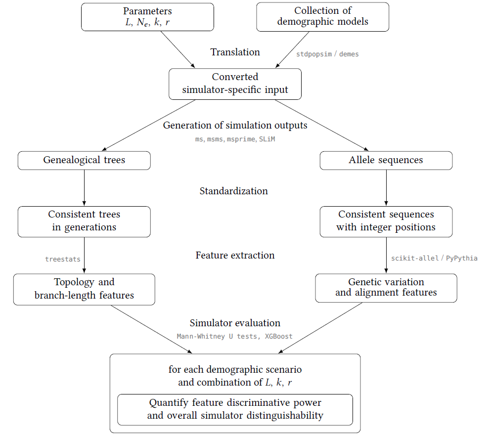

# Population Genetic Simulator Benchmark

**A systematic comparison of coalescent and forward-time population genetic simulators.**

This repository contains the code and workflows developed for a systematic evaluation of population genetic simulators. The project investigates how different simulation frameworks compare in terms of their generated genealogies and genetic variation across a diverse range of demographic scenarios.

The benchmark focuses on three coalescent simulation approaches — `ms`, `msms`, and `msprime` — and the forward-time simulator `SLiM`.

## Overview

Population genetic simulations are widely used to study evolutionary processes and generate data under specified demographic models. However, different simulation frameworks may produce systematically different outputs, even when parameterized using the same demographic history.

This project addresses this issue by comparing simulation outputs across multiple demographic models and parameter configurations. Summary statistics describing both genetic variation and genealogical structure are used to assess simulator comparability. In addition, supervised machine-learning approaches are applied to investigate whether simulation outputs can be distinguished based on the simulator that generated them.

The main objectives are:

- Evaluate the comparability of commonly used population genetic simulators.
- Investigate simulator-specific differences across demographic scenarios.
- Compare allele-based and tree-based summary statistics.
- Assess the influence of recombination on simulator comparability.
- Identify systematic differences between coalescent and forward-time simulations.

## Simulators

The benchmark includes the following simulation frameworks:

| Aspect | ms (msHOT) | msms | msprime | SLiM |
|---|---|---|---|---|
| Simulation paradigm | Coalescent | Coalescent | Coalescent | Forward-time |
| Mutation model | Infinite-sites | Infinite-sites | Infinite- and finite-sites | Finite-sites |
| Recombination | Uniform / rate maps | Uniform | Uniform / rate maps | Uniform / rate maps |
| Selection | Not implemented | Limited | Selective sweeps only | General individual-based |
| Genealogical representation | Marginal trees | Marginal trees | Implicit ARG (tree sequence) | Explicit genealogy |

Demographic models are specified using the [`demes`](https://popsim-consortium.github.io/demes-spec/) framework to provide a common basis for simulator parameterization.

For forward-time simulations, [`stdpopsim`](https://stdpopsim.readthedocs.io/) is used to execute SLiM simulations and perform subsequent recapitation with msprime.

## Methodology

A standardized simulation pipeline was developed to enable a controlled and systematic comparison of outputs generated by different population genetic simulators. The workflow separates simulator-specific execution from downstream analysis while harmonizing demographic model specifications, parameter settings, and data processing across simulators. This ensures that observed differences primarily reflect the simulation software rather than inconsistencies in model specification or subsequent analyses.



*Figure: Overview of the simulation, standardization and analysis pipeline.*

The pipeline consists of five main steps:

1. **Demographic model and parameter specification** – Define demographic models and simulation parameters in a standardized manner.
2. **Simulation execution** – Run the different population genetic simulators using the corresponding model specifications and parameter settings.
3. **Output standardization** – Harmonize simulator outputs to ensure consistent downstream processing and comparison.
4. **Feature extraction** – Extract allele-based and tree-based summary statistics from the standardized outputs.
5. **Simulator evaluation** – Assess simulator distinguishability using statistical comparisons and supervised machine-learning approaches.

All simulations and downstream analyses are implemented in a reproducible workflow using [Snakemake](https://snakemake.readthedocs.io/) (version 9.14.6; Mölder et al., 2021).

## Simulation scenarios

The benchmark includes three simulation settings:

- **Without recombination:** Simulations conducted without recombination.
- **With recombination:** Simulations conducted using a constant recombination rate across the simulated genomic region.
- **SLiM comparison:** Workflows comparing forward-time simulations with coalescent simulation outputs.

The simulations cover 11 demographic models, ranging from simple single-population scenarios to complex multi-population demographic histories. The number of present-day populations and sample sizes per population vary across models, as summarized below.

| Model identifier | Present-day populations | Sample sizes per population | Recombination |
|---|---:|---|---|
| `one_population` | 1 | 4, 8, 16, 32, 64, 128 | Yes |
| `zigzag` | 1 | 4, 8, 16, 32, 64, 128 | Yes |
| `li_african3epoch` | 2 | 4, 8, 16, 32, 64 | No |
| `lavretsky_ducks` | 2 | 4, 8, 16, 32, 64 | No |
| `locke orangutan` | 2 | 4, 8, 16, 32, 64 | Yes |
| `gutengunst_ooa` | 3 | 4, 8, 16, 32, 64 | Yes |
| `browning_america` | 4 | 4, 8, 16, 32 | Yes |
| `pawar_gorilla` | 5 | 4, 8, 16, 32 | Yes |
| `freedman_wolf` | 6 | 4, 8, 16, 32 | Yes |
| `kamm_westerneurasia` | 9 | 4, 8, 16 | Yes |
| `jacobs_papuans` | 10 | 4, 8, 16 | Yes |

Sequence lengths range from \(10^3\) to \(10^6\) base pairs.

## Repository structure

```text
.
├── config/                 # Demographic models, simulation parameters, workflow configuration, and file paths
├── data/                   # Simulation outputs and processed data
├── results/                # Analysis results and figures
├── Snakefile               # Main Snakemake workflow
├── snakemake_vars.py       # Dynamic rule inputs/outputs and memory estimation
├── rules/                  # Individual Snakemake rules
├── envs/                   # Conda environments for individual rules
├── scripts/                # Helper scripts for error logging
├── bin/                    # Simulator executables (e.g. ms, SLiM)
├── lib/                    # Supporting files required by simulators (e.g. msms)
├── src/                    # Source code for downstream analysis
├── requirements.txt        # Python dependencies
└── README.md
```

## Installation

Clone the repository:

```bash
git clone https://github.com/uvkxu/popgen-simulator-comparison.git
cd popgen-simulator-comparison
```

Install the required Python packages:

```bash
pip install -r requirements.txt
```

Additional simulation software may need to be installed separately. Please refer to the respective documentation for installation instructions.

## Usage

The repository uses a Snakemake workflow to execute all simulations and downstream analyses. By default, all configured simulation scenarios and analyses are included in the workflow. The workflow can be customized through the configuration files described below.

### 1. Configuring simulation parameters

Simulation parameters are specified in:

`config/parameter_setting/simulation_parameters.yaml`

This file defines the parameter combinations used for the simulations, including:

- Sample sizes
- Sequence lengths
- Recombination rates

To restrict the simulations to specific scenarios (e.g., simulations without recombination only) or to use different parameter combinations, modify the corresponding settings in this file.

### 2. Configuring the workflow

Additional workflow settings are specified in:

`config/workflow_config.yaml`

This file defines:

- **Target simulators:** The simulators included in the comparison.
- **Maximum overall samples:** The maximum number of samples across all populations.
- **Internal replicates:** The number of simulation replicates per parameter combination.
- **External replicates:** The number of independent repetitions of the simulation workflow.

These settings can be adjusted according to the requirements of the analysis.

### 3. Running the workflow

After adjusting the configuration files, execute the workflow using:

```bash
snakemake --use-conda --cores <number_of_cores>
```

Snakemake automatically determines the required simulation and analysis steps based on the configured parameters and selected simulators. The required Conda environments are created automatically.

### 4. Advanced configuration

The file `snakemake_vars.py` dynamically determines the inputs and outputs of individual rules based on the parameters specified in the configuration files. It also estimates the memory requirements of individual rules.

Although these definitions can be modified directly, this is **not recommended**, as changes may interfere with the automatic workflow configuration. Instead, simulation parameters and workflow settings should be adjusted through the corresponding configuration files.

## Results

The analyses investigate simulator comparability using both statistical effect sizes and machine-learning classification performance.

The main findings indicate that:

- Coalescent simulators produce broadly similar outputs, with generally small differences.
- More pronounced differences occur between coalescent and forward-time simulations.
- Combining allele-based and tree-based summary statistics provides a useful representation for distinguishing simulation outputs.

Further details and visualizations are provided in the accompanying thesis:

**[Title of Master's Thesis]**  
[Author, University, Year]

## Reproducibility

The repository is intended to support reproducibility of the simulation and analysis workflows.

The software versions used in the study include:

| Software | Version |
|---|---|
| `demes` | 0.2.3 |
| `msms` | 3.2rc-b163 |
| `msprime` | 1.3.4 |
| `SLiM` | 5.1 |
| `stdpopsim` | 0.3.0 |

The version of `ms` corresponds to the Hudson reference implementation.

Random seeds, simulation parameters, and configuration files should be retained alongside the generated outputs to facilitate reproducibility.

## Citation

If you use this repository in your research, please cite the associated thesis or publication:

```bibtex
@mastersthesis{<citation-key>,
  author = {<Author>},
  title  = {<Thesis Title>},
  school = {<University>},
  year   = {<Year>}
}
```